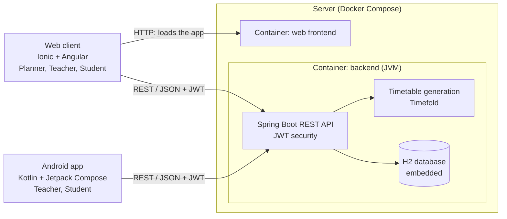

<p align="center">
  
</p>

<h1 align="center">STudo</h1>

<p align="center">
  <b>Automated timetable generation and live substitution management for schools.</b><br />
  A full-stack system: Spring Boot REST backend, Ionic/Angular web client and a native Android app.
</p>

<p align="center">
  
  
  
  
  
  
</p>

<p align="center">
  <a href="#overview">Overview</a> ·
  <a href="#features">Features</a> ·
  <a href="#technology-stack">Tech stack</a> ·
  <a href="#getting-started">Getting started</a> ·
  <a href="#documentation">Documentation</a> ·
  <a href="#my-contribution">My contribution</a>
</p>

---

## Overview

STudo helps a school's administration plan, publish and maintain its timetables. Planners enter the school's master data once (teachers, classes, rooms, period grid, curriculum quotas and the applicable rule set), and STudo generates several complete, conflict-free timetable variants automatically. When reality interferes, for example when a teacher falls ill or a room is blocked, planners record the event and the system proposes valid substitutes and alternative rooms. Teachers and students see the result immediately, including every change, in the web client or on their Android device.

The project was built by a team of eight students in a four-week software engineering project at Kiel University (CAU) in summer 2026. It targets *Gymnasien* in Schleswig-Holstein and is designed for a single school per installation.

## The problem it solves

School timetabling is a constraint-satisfaction problem with a long tail of exceptions. A valid plan has to respect teacher availability and workload limits, room types and capacities, mandatory subjects per grade level, double-lesson blocks and break rules, all at the same time. Many schools still maintain such plans in spreadsheets or legacy tools, and the work does not end once the plan exists: sickness, room closures and extra lessons force daily changes that must reach every affected teacher and student without delay.

STudo addresses three concrete pain points:

- **Creating a plan is slow and error-prone.** STudo generates multiple scored variants from the master data and rule set and reports remaining conflicts instead of hiding them.
- **Short-notice changes are hard to resolve.** An assistant function offers only those substitute teachers and rooms that do not create new conflicts.
- **Information reaches people late.** Teachers and students get a read-only, role-specific view with colour-coded changes on the web and on Android.

## Features

**Planners (web client)**

- Configure master data: school profile, period grid, break rules, maximum workloads, mandatory subjects and weekly lesson quotas per grade level, double-lesson preferences, grade-level priorities and substitution priorities
- Manage classes, teachers (including availabilities and preferred classes), students, rooms and administrators, with deactivation and reactivation instead of hard deletion
- Generate complete school timetables automatically and compare three school-wide variants, review them class by class, adjust single lessons with conflict-free suggestions, and publish a variant (the previously active plans are archived)
- Record events (teacher absence, room blocking, extra lesson) that turn into open changes, then resolve them in a colour-coded substitution plan
- Browse the change history and event history with search and filters; room schedules; a school-wide view with an archive and a school-year rollover
- Built-in user manual and profile and password management

**Teachers and students (Android app, partly also web)**

- Personal weekly and daily timetable with colour-highlighted changes (cancelled lesson, substitution, room change, extra lesson)
- List of relevant changes with an unread counter
- Room schedules for teachers
- Persistent login and a configurable server address

**Platform**

- Stateless JWT authentication with three roles (planner, teacher, student) and role-based access rules
- One REST API shared by the web client and the Android app
- Containerised deployment with Docker Compose, embedded H2 database, demo data on first start

Screenshots and a feature walk-through are in [docs/screenshots.md](docs/screenshots.md).

## Technology stack

| Layer | Technologies |
|---|---|
| Backend | Java 21, Spring Boot 4.1, Spring Web (REST), Spring Data JPA / Hibernate, Spring Security with JSON Web Tokens, Lombok, Gradle |
| Timetable generation | [Timefold Solver](https://timefold.ai/) (open-source constraint solver) with domain-specific hard and soft constraints |
| Database | H2 2.4 (embedded, file-based persistence); schema derived from JPA entities |
| Web client | Ionic with Angular |
| Android app | Kotlin 2.2, Jetpack Compose, minimum SDK 30 (Android 11) |
| Build and delivery | Docker, Docker Compose, GitLab CI (original pipeline) |
| Design | Figma mockups, UML models |

## Architecture at a glance



Both clients talk to the same REST API, so they can be developed and deployed independently as long as they honour the API contract. The Android app is deliberately a read-only client. A detailed description is available in [docs/architecture.md](docs/architecture.md).

## Getting started

### Prerequisites

- Git and Docker with Docker Compose v2 (developed with Docker 29 and Compose v5)
- For the Android app: Android Studio and an emulator or device with Android 11 (API 30) or newer
- For backend development outside Docker: JDK 21

### Run the backend and the web client

```bash
git clone <repository-url>
cd <repository>
docker compose up --build
```

By default the web client is served on port **8081** and the REST API on port **8080** (see `docker-compose.yml`). Open `http://localhost:8081` in a browser.

Configuration is passed through environment variables, optionally via a `.env` file next to `docker-compose.yml`. Set a strong `JWT_SECRET` for every deployment that is reachable from a network.

### Demo data and accounts

On first start the application seeds a small demo school: user accounts for all three roles, classes, rooms and a default school configuration. Timetables and events are created through the application itself. Generating the timetables of the demo school takes about six minutes.

| Role | Username | Password |
|---|---|---|
| Planner | `frauke-lindner` | `#TeamKommis4life!` |
| Planner | `birgit-otto` | `STudoAufDie1!` |
| Teacher | e.g. `anke-mueller` | `start1234` |
| Student | e.g. `lena-paulsen` (class 5a) | `start1234` |

All teacher and student accounts share the password `start1234`. Usernames are generated by the system in the form `firstname-lastname`. Log in as a planner first: the teacher and student lists show the usernames of all other seeded accounts.

> **Note:** These credentials exist only for the local demo data. Change them (and set your own `JWT_SECRET`) before exposing an instance to any network.

### Reset to a clean state

```bash
docker compose down -v
docker compose build --no-cache
docker compose up
```

### Android app

1. Open the `Studo-App` directory in Android Studio and run the app on an emulator or a device (API 30 or newer).
2. On the login screen tap the gear icon in the top right corner and enter the server address, for example `http://10.0.2.2:1600/` for an emulator talking to the backend on the host machine, or `http://<your-lan-ip>:1600/` for a physical device in the same network.
3. Log in with a teacher or student account.

### Run the tests

```bash
# Backend unit tests
cd backend && ./gradlew test

# Android unit tests
cd Studo-App && ./gradlew test

# Android UI tests (emulator must be running)
cd Studo-App && ./gradlew connectedAndroidTest
```

More on the test approach in [docs/testing.md](docs/testing.md).

### Repository layout

| Path | Content |
|---|---|
| `backend/` | Spring Boot application: REST API, business logic, persistence, security, timetable generation |
| `Studo-Web/` | Ionic/Angular web client |
| `Studo-App/` | Android app |
| `docs/` | Architecture, requirements, design decisions, testing, screenshots |
| `docker-compose.yml` | Local and server deployment of backend and web client |

## Documentation

| Document | Content |
|---|---|
| [Screenshots](docs/screenshots.md) | The web client and the Android app in action |
| [Architecture](docs/architecture.md) | Component interplay, REST API, database, security, timetable generation algorithm |
| [Requirements](docs/requirements.md) | Summary of the requirements specification: scope, use cases, data, implementation status |
| [Design decisions](docs/design-decisions.md) | The most important architecture decisions with context and consequences |
| [Testing and technical notes](docs/testing.md) | Test concept, acceptance tests, technical particularities, known limitations |
| [My contribution](docs/my-contribution.md) | What I built within the team project |

> Identifiers in the code base (classes, entities, DTOs) are in German because they mirror the domain language of the customer. [docs/architecture.md](docs/architecture.md#naming-the-domain-in-english-and-german) contains a mapping to the English terms used throughout the documentation.

## My contribution

I was part of the backend team (database and backend, with a focus on security) and took the following responsibilities:

- **Security:** end-to-end JWT authentication and role-based authorisation with Spring Security, including the account and password model
- **Teacher view and room plans:** the backend services and DTOs behind the teacher view of the Android app
- **Assistant function and change handling:** suggestions for substitute teachers and alternative rooms, and the creation of events and the changes they trigger
- **Integration and deployment:** connecting backend, web client and Android app (endpoints, data types, CORS, exception handling) and getting the Docker-based deployment running on the server
- **Quality and workflow:** the first backend tests and a runnable main branch at all times
- **Documentation:** the product data and product usage chapters of the requirements specification

The full account is in [docs/my-contribution.md](docs/my-contribution.md).

## Project status and limitations

All must-have requirements were implemented and demonstrated at submission. Some optional features were intentionally left out because of time constraints, a team member dropping out during the project, or an explicit decision of the customer:

- Push notifications for teachers
- Viewing timetables and changes beyond the current week (the backend queries are prepared for it)
- Elective courses and working groups with differing student sets, and weekly alternating courses (descoped together with the customer)
- Night mode and an optimised landscape layout in the Android app (partially prepared)

The complete status per requirement is listed in [docs/requirements.md](docs/requirements.md#implementation-status).

## Team

Built by eight students of Kiel University as a team project.

| Name | Responsibility |
|---|---|
| Viktoria Algaier | Modelling, frontend (Android) |
| Finia Kock | Frontend (web) |
| Mark-Daniel Lüthje | Frontend (Android), CI/CD, testing |
| Marius Neumann | Database, backend |
| Lisa Reisig | Frontend (web), mockups |
| Izabella Rey | Database, backend (focus: security) |
| Julian Schilf | Database, backend (focus: algorithm) |
| Antonia Woldt | Modelling, frontend (web) |

## License

Released under the [MIT License](LICENSE).
