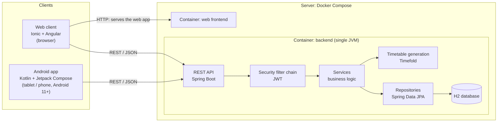
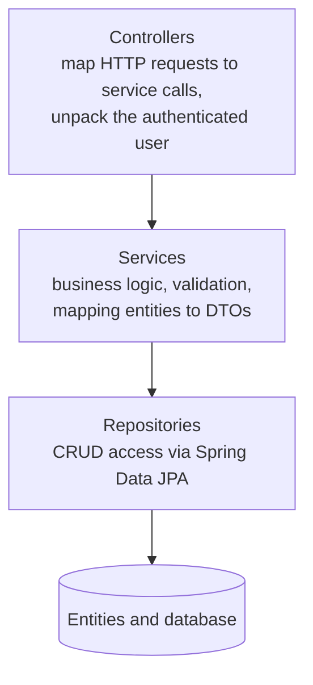
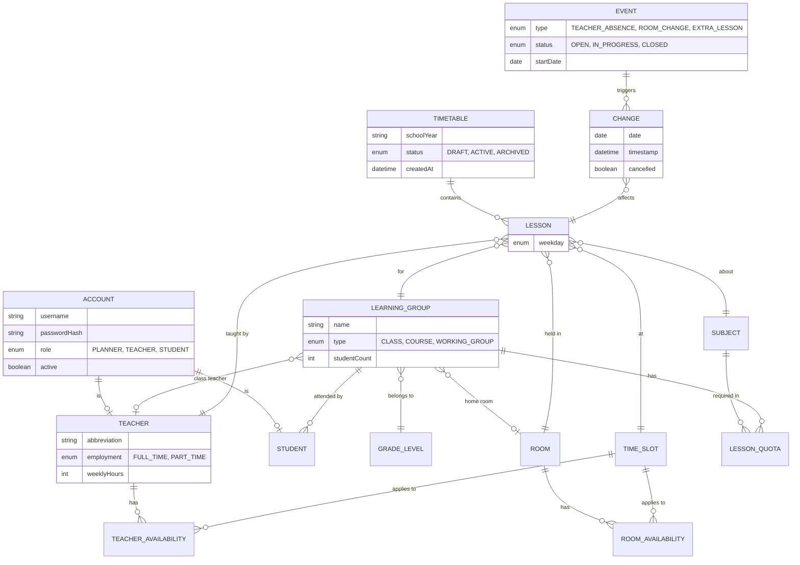
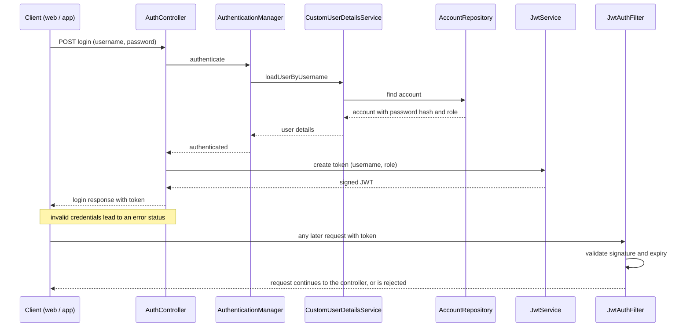
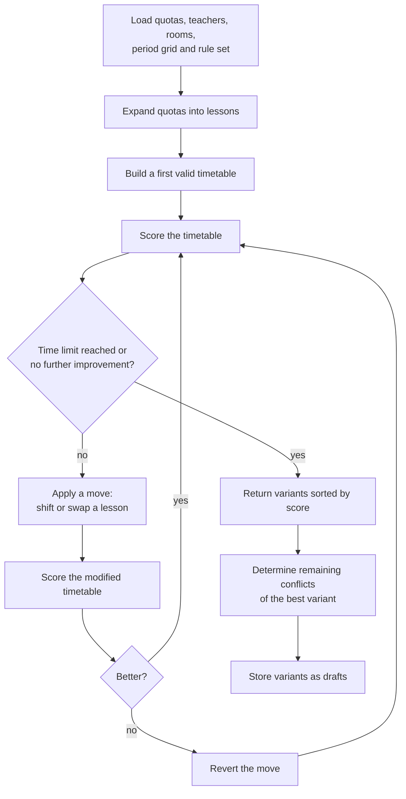
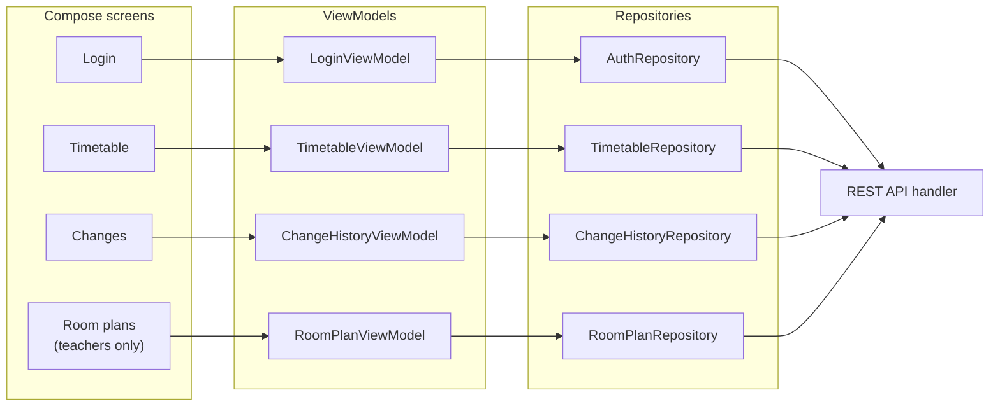

# Architecture

This document describes how STudo is put together: how the backend, the web client and the Android app interact, how the REST API and the database are structured, how security works, and how the timetable generation algorithm produces its results.

**Contents**

1. [System overview](#system-overview)
2. [Backend](#backend)
3. [REST API](#rest-api)
4. [Database](#database)
5. [Security](#security)
6. [Timetable generation algorithm](#timetable-generation-algorithm)
7. [Assistant function for changes](#assistant-function-for-changes)
8. [Web client](#web-client)
9. [Android app](#android-app)
10. [Deployment](#deployment)
11. [Naming: the domain in English and German](#naming-the-domain-in-english-and-german)

---

## System overview

STudo consists of three deployable parts that communicate exclusively through one REST API:

| Part | Role | Users |
|---|---|---|
| **Backend** (Spring Boot) | Business logic, persistence, authentication, timetable generation | none directly |
| **Web client** (Ionic + Angular) | Full-featured client: configuration, planning, administration and read-only views | Planners, teachers, students |
| **Android app** (Kotlin + Jetpack Compose) | Mobile read-only client for timetables, changes and room schedules | Teachers, students |



The browser loads the web application from the frontend container and then calls the backend API directly. Because the two containers are served from different origins, the backend carries an explicit CORS configuration.

Two properties of this layout shape most other decisions:

- **One API contract for all clients.** Web and Android see exactly the same data model and security rules, which keeps both consistent and lets the teams work independently once the contract is agreed. The contract was defined up front in the design documentation, before the implementation started.
- **Thin clients.** The Android app contains no business logic for changing timetable data. It only fetches what planners maintain through the web client.

## Backend

### Layering

The backend follows a classic three-layer structure:



- **Controllers** are intentionally thin. They translate requests into service calls, extract the identity from the authenticated principal and return DTOs.
- **Services** hold the business logic and may use several repositories. The timetable generation service and the assistant service live here.
- **Repositories** are Spring Data interfaces, one per entity.
- **DTOs are separate from entities.** The API never serialises JPA entities. DTOs flatten and reshape data for the clients and avoid lazy-loading problems, infinite recursion in bidirectional relations and accidental exposure of internal fields. DTOs are organised by feature (for example class views, app views, master data).

### Logical components

The design documentation structures the backend into the following functional components. Every component accesses persistent data through the shared data layer.

| Component | Responsibility |
|---|---|
| Authentication | Login and token issuing |
| Account management | User accounts for planners, teachers and students |
| Master data management | Teachers, classes and courses, rooms, period grid |
| Rule set management | Rules per school type and federal state: maximum workloads, breaks, block rules, mandatory subjects |
| Timetable generation | Produces conflict-free, scored timetable variants |
| Timetable management | Serves timetables in all views (school, class, teacher, room) |
| Change management | Records events and the resulting changes, keeps the change history |

## REST API

The API is a stateless JSON interface. Every request except the login carries a JSON Web Token; authorisation rules are enforced centrally in the Spring Security filter chain (see [Security](#security)).

### Functional areas

| Area | Used by | Purpose |
|---|---|---|
| Authentication | all | Log in and obtain a token |
| Dashboard | planner | Counters (classes, rooms, teachers, open events) and the most recent changes |
| Master data and rule set | planner | School profile, period grid, break rules, maximum workloads, subject quotas, block rules, priorities |
| Classes, teachers, students, admins, rooms | planner (read for teacher: rooms) | CRUD with deactivation and reactivation |
| Timetable generation and publication | planner | Start generation, retrieve variants and conflicts, publish a variant |
| Timetable views | planner, teacher, student | Timetable per class, teacher, student and room, for the current school year or from the archive |
| Events and changes | planner | Record events, retrieve suggestions for affected lessons, confirm changes |
| Change and event history | planner, teacher, student | Open and completed changes, filters and search |
| Account and profile | all | Change own password, edit profile |

### Representative DTOs

The central read model for timetables is a lesson DTO that carries everything a client needs to render a cell, including whether the lesson was changed and why:

```text
UnterrichtsstundeDTO {            // lesson
  wochentag: String               // weekday
  stundennummer: int              // period number
  start, ende: LocalTime
  fachName: String                // subject
  raumBezeichnung: String         // room
  lerngruppeKuerzel: String       // class / learning group
  geaendert: boolean              // changed compared to the base timetable
  freistunde: boolean             // cancelled without substitute
  grund: String                   // reason for the change
}
```

Other central DTOs are the master data bundle (school profile, period grid, workloads, break rules, mandatory subjects, substitution priorities), the dashboard summary, the event DTO (type, date, status, author, affected teacher, room or class, reason) and a timetable DTO with a plan status. A large number of smaller request and response DTOs complement them.

### Typical interactions

| Use case | Interaction |
|---|---|
| Log in | `POST` credentials, receive a signed token |
| Generate timetables | `POST` with the learning group and the desired number of variants, receive the variants with their remaining conflicts |
| Resolve a change | `GET` suggestions for the affected lesson, then `PUT` the chosen solution |
| Show a timetable | `GET` the timetable of a class, teacher or room |

## Database

STudo uses an **embedded H2 database** that runs inside the backend JVM and persists to a file inside a Docker volume. The schema is derived from the JPA entities by Hibernate, and a seed file creates the demo school on first start. Choosing an embedded database keeps the installation to two containers and removes the need to operate a database server for a single-school deployment.

### Entity overview



The diagram is simplified. The most important modelling aspects:

- **Accounts and roles.** Every person who logs in has an account with exactly one role. Teachers and students are separate entities linked to an account.
- **Learning groups.** Classes, courses and working groups share one entity with a type attribute, which keeps the model open for electives even though these were descoped from the delivered scope.
- **Availability.** Teacher availability is expressed per weekday and time slot with a type (preferred, neutral, not preferred, blocked) and a validity period. Room availability follows the same pattern.
- **Timetables.** A timetable has a status (draft, active, archived), a validity period, a school year and half year, and an author. Generated variants are stored as drafts until a planner publishes one; publishing archives the formerly active plans.
- **Events and changes.** An event (teacher absence, room blocking or extra lesson) is a specialised entity of its own type. Each event can trigger several changes, because one absence affects every lesson of that teacher on the affected days. A change references the affected lesson and carries the new teacher, room or subject, or marks the lesson as cancelled. The change history is derived from these records.
- **Rules.** Each rule type (maximum workload, break rule, block rule, mandatory subject) references a general constraint entity with an active flag and carries a hardness (hard or soft) and a weight. See the [algorithm section](#timetable-generation-algorithm).
- **Enumerations** are used wherever a field has a fixed value range, for example role, weekday, room type, availability type, plan status and event status.

## Security

Authentication is stateless and based on JSON Web Tokens.



Key points of the design:

- **Passwords are hashed** with a Spring `PasswordEncoder`, which is configured in its own configuration class so that replacing the user details service later cannot break the bean wiring.
- **The token carries username and role.** The `JwtAuthFilter` validates it on every request and populates the security context.
- **Authorisation rules are enforced centrally** in the `SecurityFilterChain` by role. The frontends hide buttons for unauthorised actions only as a usability measure. The backend is the only authority.
- **Identity comes from the token, not from the request body.** Controllers that modify personal data derive the user from the authenticated principal and pass only the username to the service. This prevents insecure direct object reference (IDOR) attacks and keeps services easy to test.
- **Two distinct password flows.** Self-service password change requires the old password. A planner can reset a teacher's or student's password, which sets a flag that forces a change. There is deliberately no e-mail based reset, which was an explicit customer requirement.
- **Secrets stay out of the code.** The JWT signing secret is read from the environment with a development default and must be overridden for real deployments.
- **System-generated usernames** in the form `firstname-lastname` replace e-mail based logins.

## Timetable generation algorithm

Generating a school timetable is a combinatorial optimisation problem. STudo models it with the open-source [Timefold Solver](https://timefold.ai/), which provides the search algorithms and the score mechanics, while the domain model and the constraints are specific to STudo.

### Inputs

The generation service loads everything from the database and expands it into planning units:

- **Lesson quotas** per learning group and subject: how many lessons per week are required, optionally with a preferred teacher. Each quota is expanded into individual lessons to be placed.
- **Teachers** with their subjects, workload (employment and weekly hours) and availability.
- **Rooms** with type and capacity, and the **room type each subject requires**, for example a specialised room or a sports hall.
- **Period grid**: the weekdays and time slots, including breaks.
- **Active rule set** for the school.

### Constraints and scoring

Every rule carries a **hardness** and a **weight** as data attributes, so the rule set stays configurable instead of being hard-coded into the solver:

| Hardness | Meaning |
|---|---|
| Hard | Must hold, otherwise the plan is invalid. Typical example: a teacher, room or class cannot be in two places at the same time. |
| Soft | Should hold. Each violation reduces the score by the rule's weight. Typical examples: availability preferences of teachers, double-lesson blocks for configured subjects, avoiding free periods. |

The rule types supported by the data model are:

- **Maximum workload** per grade level or teacher: lessons per day, lessons per week, and consecutive lessons without a break
- **Break rules** per grade level: the minimum break duration and the maximum number of consecutive lessons before a break
- **Block rules**: a subject must be taught in double lessons in a grade level
- **Mandatory subject rules**: a grade level must receive a minimum number of weekly lessons in a subject
- **Teacher availability**: preferred, neutral, not preferred and blocked slots with a validity period

Each plan is scored as a hard/soft pair. Plans with fewer hard violations always win, and the soft score decides between otherwise equal plans. A separate **grade-level priority** lets planners define which grade levels should receive free periods last: a grade level that appears higher in the priority list is less likely to end up with gaps in its plan.

### Search process



1. The service creates an initial valid plan and scores it.
2. In a loop it applies one move at a time, either shifting a lesson to another slot or swapping it with another lesson, re-scores the plan, and keeps the move if the result improves.
3. The loop ends when the time limit is reached or when no more improvement is found.
4. The result is a list of plan variants sorted by score. Remaining conflicts of the best variant are determined and returned alongside the variants.
5. All variants are stored as drafts. The planner reviews them class by class, adjusts single lessons, selects one school-wide variant and publishes it. Publishing archives the previously active plans.

For the demo school a full generation takes about six minutes and yields three school-wide variants. The web client keeps working while the solver runs and shows a notification when the result is ready, provided the planner stays on the page.

## Assistant function for changes

Short-notice changes are modelled as **events** that trigger **changes**:

1. A planner records an event on the dashboard: teacher absence, room blocking or extra lesson. The event creates one open change for every affected lesson.
2. For each open change, the assistant service determines solutions. For a teacher absence it finds substitute teachers who are available in that slot and do not create a conflict. For a room blocking or an extra lesson it finds alternative rooms that are free in that slot.
3. The planner picks a suggestion in the substitution plan and confirms it. The change is persisted, moves from open to completed and appears in the change history. Affected lessons are highlighted for teachers and students.

Only conflict-free candidates are offered, so the planner cannot accidentally trade one conflict for another.

## Web client

The web client is an Ionic application built with Angular. A layout page provides the navigation and top bar and hosts the individual pages via routing. The pages depend on the layout through composition rather than inheritance.

| Role | Accessible pages |
|---|---|
| Planner | Dashboard, classes, rooms, teachers, students, admins, change history, event history, master data, school view, user manual, profile |
| Teacher | Own timetable, changes, rooms and room schedules |
| Student | Own timetable, changes |

All data pages communicate with the backend through a central REST handler that encapsulates the entire server communication, so the API is consumed in exactly one place. Only the user manual works without a backend connection because its content ships with the application.

## Android app

The Android app is written in Kotlin with Jetpack Compose and follows a repository and view-model structure with one slice per functional area.



- Each slice holds only UI-relevant state in its view model and delegates data access to a repository.
- A timetable consists of lessons, each in exactly one room. Week and day views share the same data; tapping a weekday switches between the weekly grid and the daily view.
- Teachers see an additional room tab with room schedules in the same grid format. Students do not.
- The app is a pure read-only client. The server address is configurable on the login screen, and the login persists across app restarts.
- A badge shows the number of changes the user has not seen yet.

## Deployment

All server components run on one host in separate Docker containers, orchestrated with Docker Compose:

- **Backend container:** a JVM running the Spring Boot application with the embedded H2 database.
- **Frontend container:** serves the built web client.
- **Clients:** any number of browsers and Android devices (Android 11 or newer).

Because web client and Android app depend only on the REST API contract, they can be built, tested and deployed independently. The backend tests ran in the continuous integration pipeline on every push to the deployment branch.

## Naming: the domain in English and German

The code base uses the German domain vocabulary of the customer. The documentation uses English terms. The most important ones map as follows:

| English (docs) | German (code) | English (docs) | German (code) |
|---|---|---|---|
| Planner | Planung | Event | Ereignis |
| Teacher | Lehrkraft | Change | Änderung |
| Student | Schüler | Teacher absence | Ausfall |
| Learning group (class, course, working group) | Lerngruppe | Room change | Raumänderung |
| Grade level | Jahrgangsstufe | Extra lesson | Zusatzstunde |
| Lesson | Unterrichtsstunde | Lesson quota | Stundenkontingent |
| Timetable | Stundenplan | Period grid | Stundenraster |
| Time slot | Zeitslot | Master data | Stammdaten |
| Room | Raum | Constraint / rule | Rahmenbedingung |
| Subject | Fach | Hardness (hard / soft) | Härte (HART / WEICH) |
| Availability | Verfügbarkeit | Break rule | Pausenregel |
| Maximum workload | Maximalbelastung | Block rule | Blockregel |
| Mandatory subject rule | Pflichtfachvorgabe | Assistant function | Assistenzfunktion |
| Substitution | Vertretung | Draft (timetable) | Entwurf |
