# Screenshots

A tour of STudo through its two clients. All screenshots show the seeded demo school.

**Contents**

1. [Web client: planner](#web-client-planner)
2. [Web client: teacher and student](#web-client-teacher-and-student)
3. [Android app](#android-app)

---

## Web client: planner

Planners work in the web client. It provides the dashboard, the management pages and the timetable tools.

### Login and dashboard

  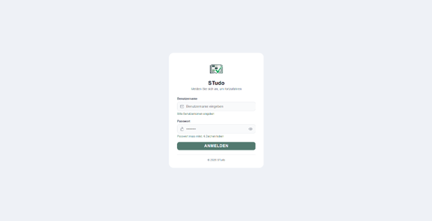
  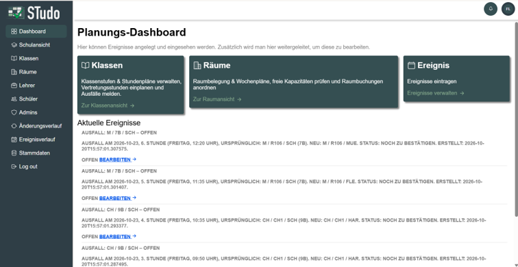

*Left: role-independent login. Right: the dashboard shows the latest changes and gives quick access to classes, rooms and event recording.*

### Generating timetables

  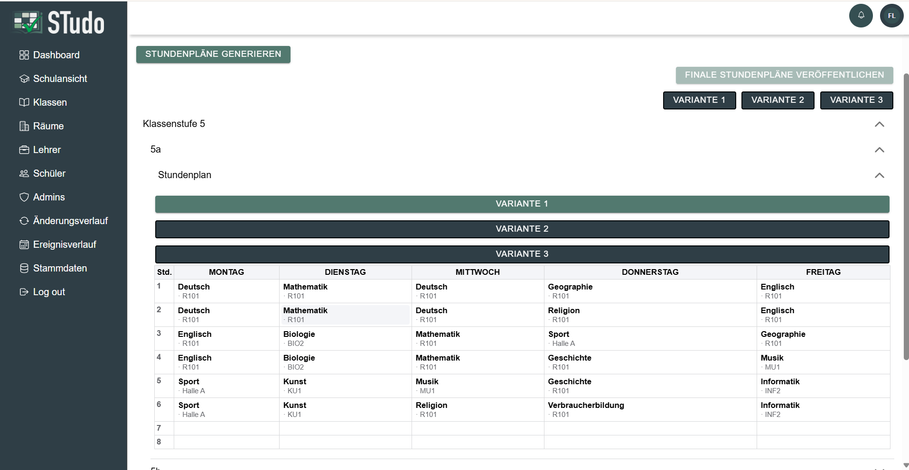

*The generator produces three school-wide variants. Planners review them class by class, adjust single lessons with conflict-free suggestions and publish one variant for the entire school.*

### Recording events and resolving changes

  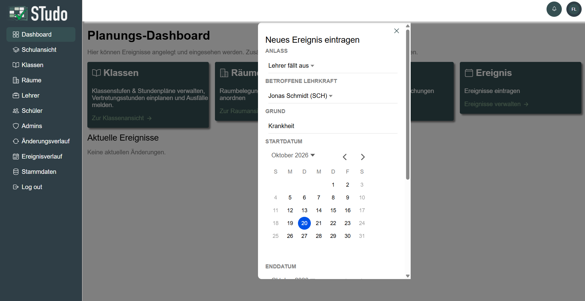
  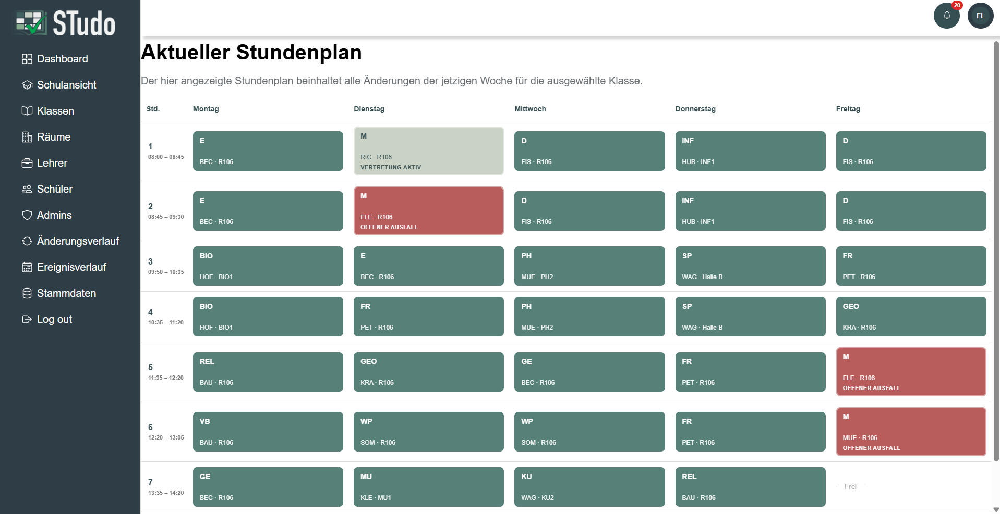

*Left: an event such as a teacher absence is recorded with a type and a date. Right: the substitution plan highlights affected lessons by colour, and the assistant offers only valid substitute teachers or rooms.*

### Master data and rules

  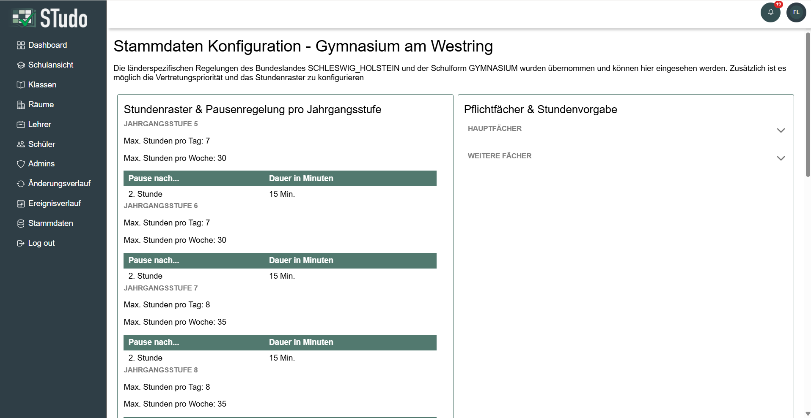

*School profile, period grid, break rules, maximum workloads, grade-level priorities, mandatory subjects and lesson quotas.*

### Classes, rooms, teachers and history

  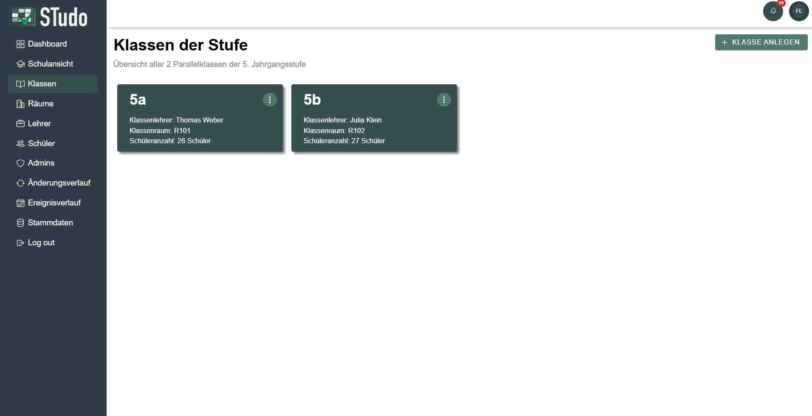
  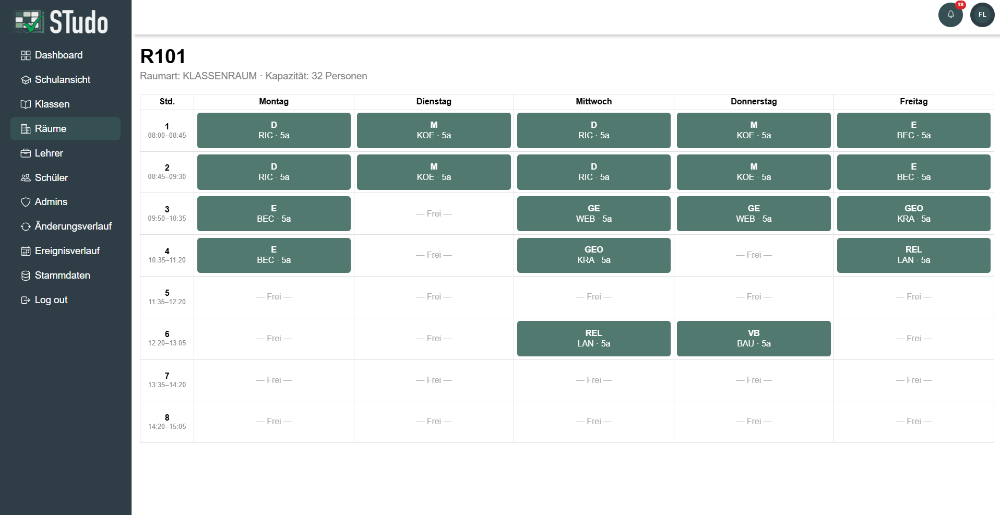

  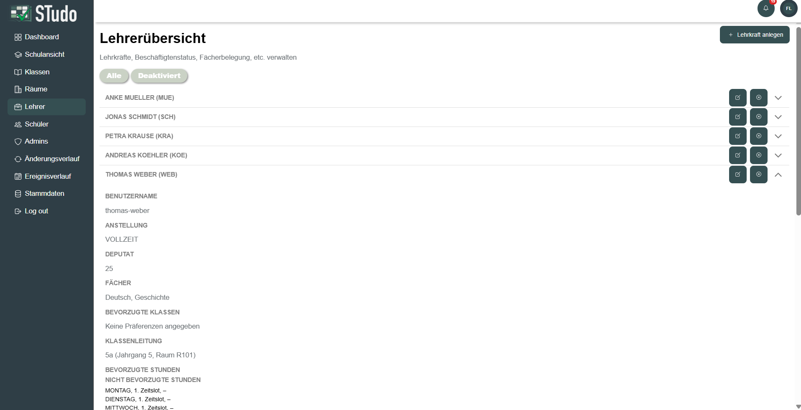
  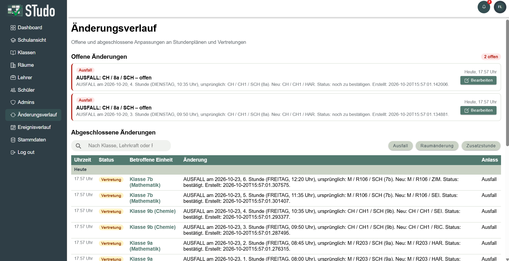

*Top: classes of a grade level with their status, and the weekly schedule of a room. Bottom: teacher management including availabilities, and the change history with open changes, search and filters.*

## Web client: teacher and student

  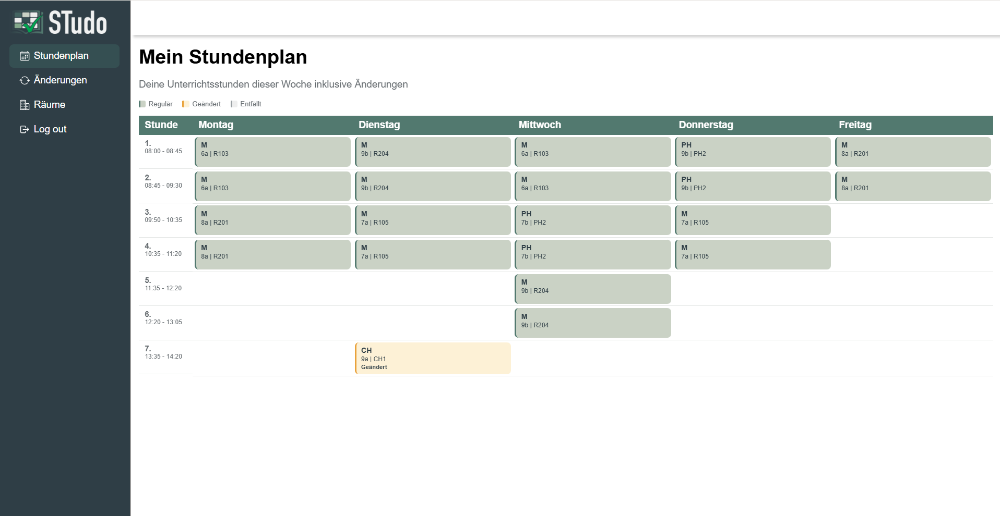
  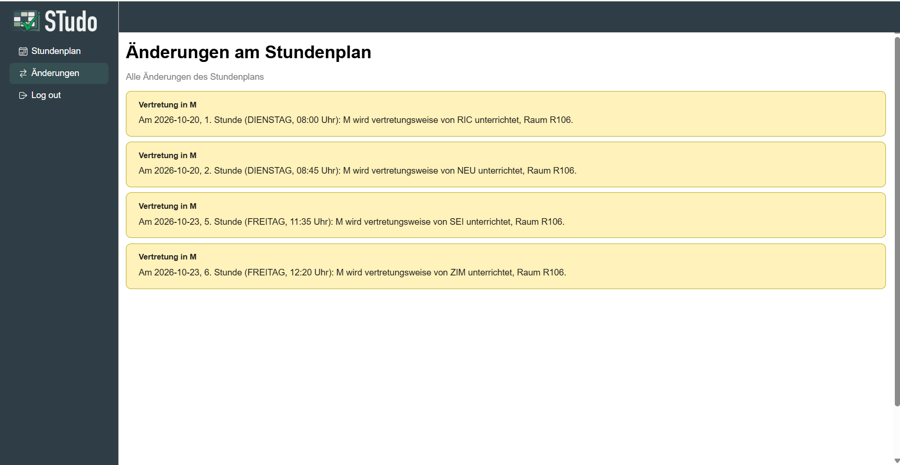

*Teachers and students see a read-only view: their own timetable with highlighted changes and the list of relevant changes. Only teachers can open room schedules.*

## Android app

  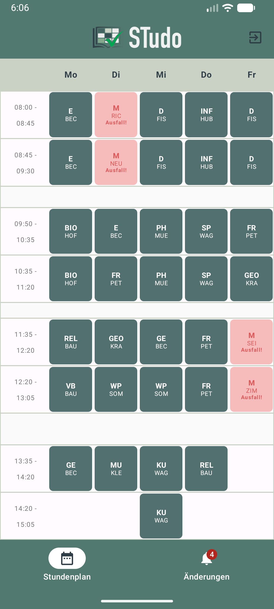
  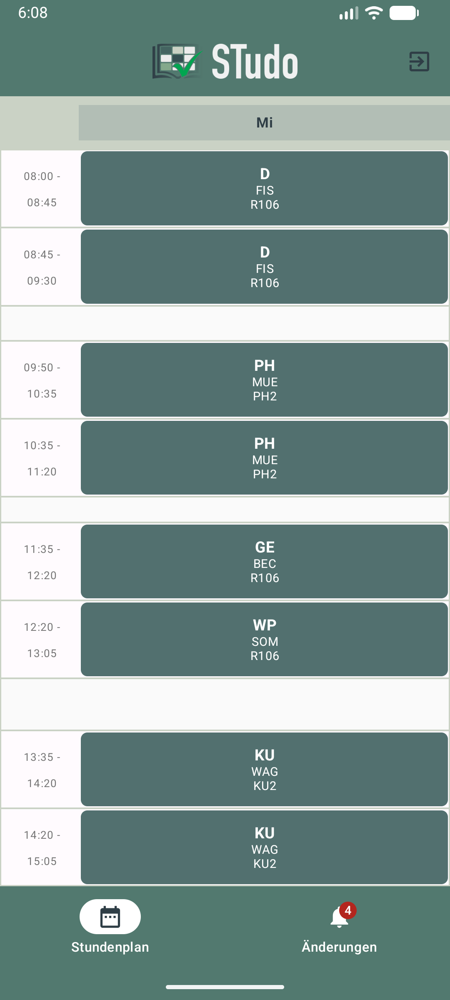
  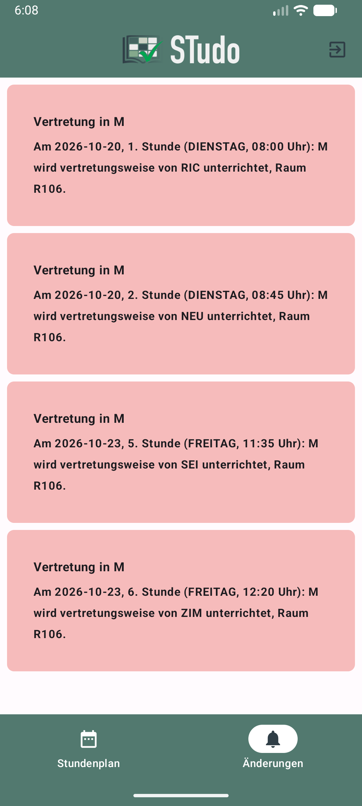
  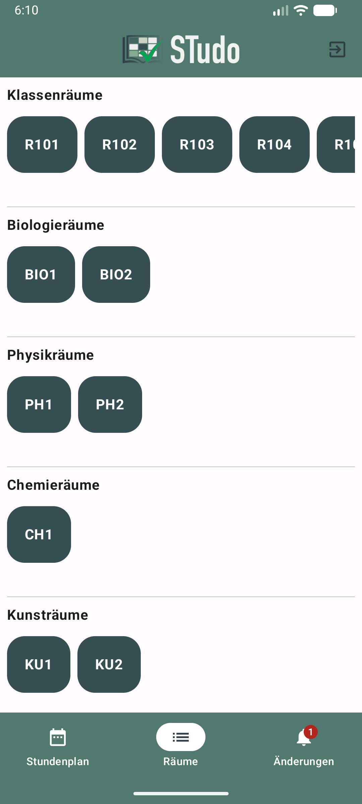
  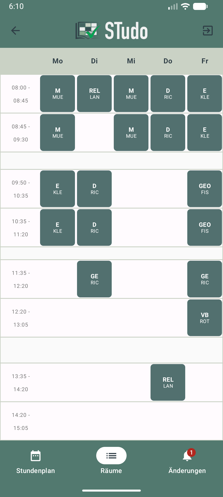

*From left to right: weekly timetable with colour-highlighted changes, daily view (tap a weekday), the change list with an unread counter, and room schedules, which only teachers can see.*
